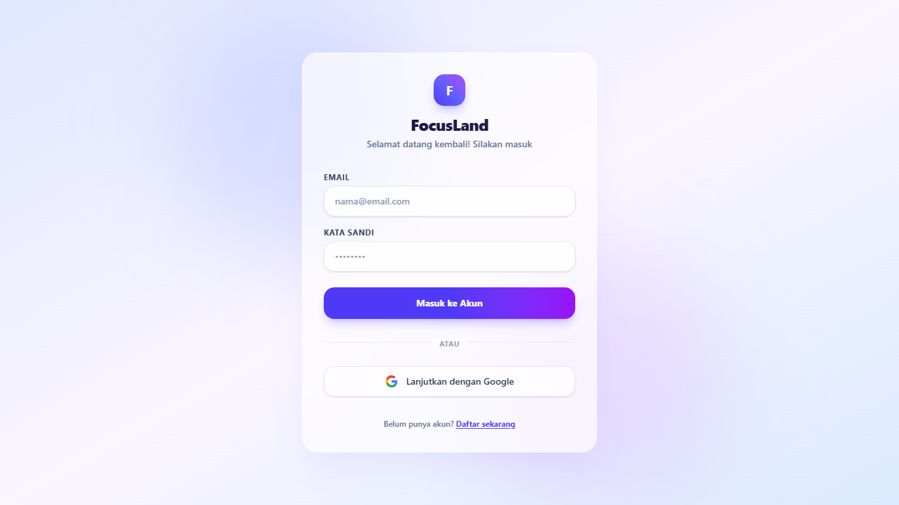
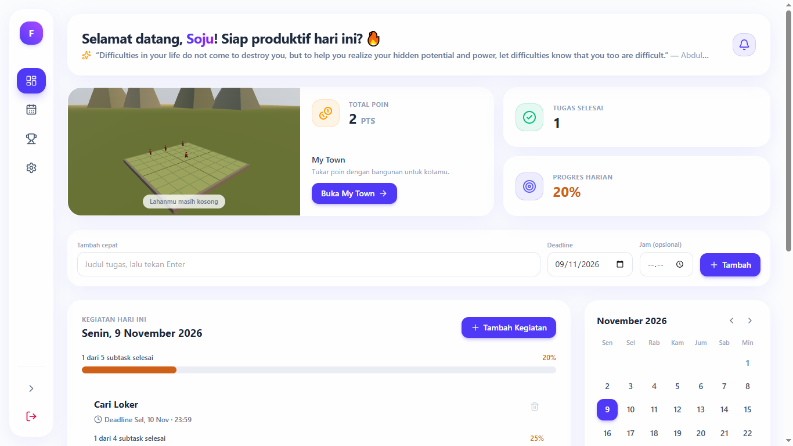
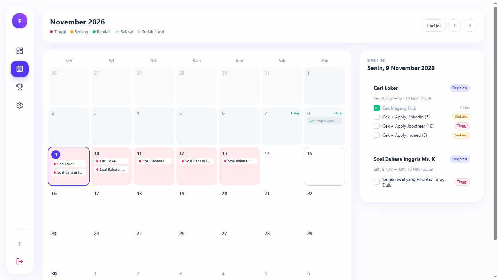
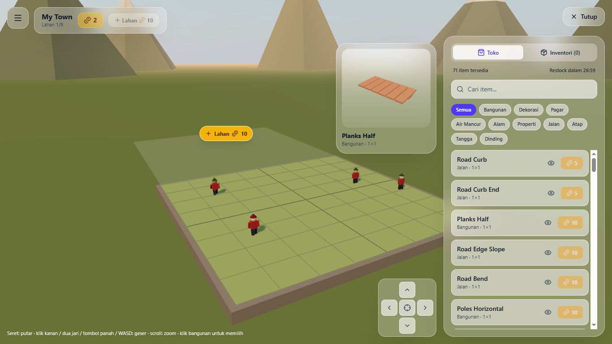
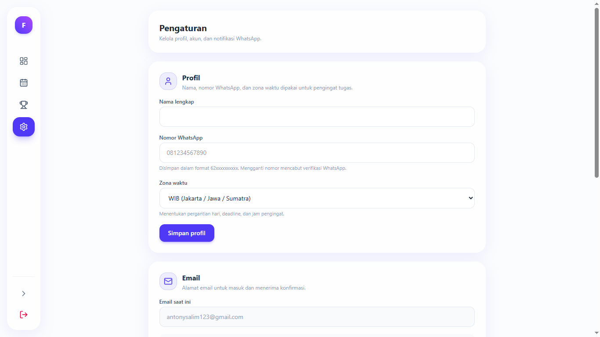
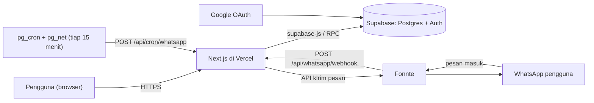

# 🏡 FocusLand

**Aplikasi to-do list bergamifikasi dengan pembangun kota 3D.** Selesaikan tugas harianmu, kumpulkan poin, lalu tukar dengan bangunan untuk membangun kotamu sendiri. Pengingat dan perintah juga tersedia lewat WhatsApp.

> *A gamified to-do list web app with a 3D town builder, WhatsApp reminders, and chat commands. Built with Next.js, Supabase, and Three.js.*







**Demo:** `https://focus-land-to-do-app.vercel.app/` &nbsp;·&nbsp; **Repositori:** [Tonylim21/Focus-Land-ToDo-App](https://github.com/Tonylim21/Focus-Land-ToDo-App)

---

## Daftar isi

1. [Fitur](#fitur)
2. [Tech stack](#tech-stack)
3. [Arsitektur](#arsitektur)
4. [Struktur folder](#struktur-folder)
5. [Database](#database)
6. [Instalasi](#instalasi)
7. [Environment variables](#environment-variables)
8. [Panduan penggunaan](#panduan-penggunaan)
9. [Integrasi WhatsApp](#integrasi-whatsapp)
10. [Deploy ke Vercel](#deploy-ke-vercel)
11. [Keamanan](#keamanan)
12. [Pemecahan masalah](#pemecahan-masalah)
13. [Status dan rencana](#status-dan-rencana)
14. [Kredit](#kredit)

---

## Fitur

**Manajemen tugas**
- Tugas punya **tanggal mulai** dan **deadline** (jam deadline opsional), sehingga satu tugas bisa tampil berhari-hari.
- Setiap tugas berisi **subtask** dengan prioritas (rendah, sedang, tinggi). Progres tugas dihitung dari subtask yang dicentang, ditampilkan sebagai bar gradasi merah → kuning → hijau.
- *Quick add*, modal tambah kegiatan, hari libur, dan bagian **Terlambat** untuk tugas yang lewat deadline.
- Notifikasi dalam aplikasi lewat ikon lonceng: terlambat, deadline hari ini, dan deadline besok.

**Gamifikasi**
- Menyelesaikan subtask tepat waktu memberi poin; terlambat tidak memberi poin dan dikenai penalti. Poin bisa negatif (hutang).
- Nilai poin per subtask **sengaja tidak ditampilkan** ke pengguna, dan total poin baru terbuka setelah satu tugas selesai.
- Semua perubahan poin tercatat di buku besar (`point_logs`) dan dihitung di database, bukan di browser.

**Kalender**
- Kalender bulanan besar ala Notion. Warna tanggal mengikuti prioritas tertinggi dari subtask yang belum selesai, tanggal yang sudah lewat meredup, dan setiap tanggal bisa diklik untuk melihat riwayat tugas.

**My Town (3D)**
- Dunia 3D interaktif (Three.js) memakai 167 model dari Kenney.nl.
- Toko dengan **restock tiap jam**, inventori, jual item (kembali 70%), beli **lahan tambahan** (sampai 9 petak, harga naik progresif).
- Pasang, pindah, **putar**, dan **tumpuk** bangunan hingga 4 lantai; dinding, pintu, dan pagar menempel di satu sisi petak sehingga rumah 1×1 pun bisa dibuat.
- Pratinjau penempatan berbentuk bangunan, pratinjau 3D berputar di toko, penduduk yang berjalan-jalan, langit senja, dan kamera yang bisa diputar, di-zoom, dan digeser.

**WhatsApp (lewat Fonnte)**
- Verifikasi nomor dengan kode.
- Ringkasan pagi, peringatan deadline, dan pengingat malam secara terjadwal.
- Perintah lewat chat: tambah tugas, lihat daftar, selesaikan, dan batalkan.

**Akun**
- Login email dan password atau Google, onboarding profil, serta halaman pengaturan (nama, email, password, nomor WhatsApp, zona waktu).

---

## Tech stack

| Lapisan | Teknologi | Fungsi |
|---|---|---|
| Framework | **Next.js 16** (App Router, Turbopack, Cache Components) | Halaman, route API, `proxy.ts` untuk proteksi rute |
| UI | **React 19**, **TypeScript**, **Tailwind CSS** | Antarmuka dengan gaya *light glassmorphism* |
| Ikon dan utilitas | `lucide-react`, `clsx`, `tailwind-merge` | Ikon dan penggabungan class |
| Backend dan database | **Supabase** (PostgreSQL, Auth, Row Level Security, RPC, `pg_cron`, `pg_net`, Vault) | Data, autentikasi, logika poin, penjadwalan |
| Klien Supabase | `@supabase/supabase-js`, `@supabase/ssr` | Akses dari browser dan server (cookie) |
| Grafik 3D | **three**, `@react-three/fiber`, `@react-three/drei` (+ `@types/three`) | Dunia My Town dan pratinjau item |
| Aset 3D | **[Kenney.nl](https://kenney.nl)**, Fantasy Town Kit (format `.glb`, lisensi CC0) | Model bangunan dan dekorasi |
| Login Google | **Google Cloud Console** (OAuth 2.0 Client) + Supabase Auth Provider | Masuk dengan akun Google |
| WhatsApp gateway | **[Fonnte](https://fonnte.com)** | Kirim pesan dan terima webhook |
| Hosting | **Vercel** (deploy otomatis dari GitHub) | Menjalankan aplikasi |
| API pihak ketiga | [DummyJSON](https://dummyjson.com) (`/quotes/random`) | Kutipan harian di dashboard |
| Kualitas kode | ESLint 9 | Linting |

---

## Arsitektur



Prinsip desainnya:
- **Browser hanya melakukan hal yang aman.** Poin, status centang, dan kepemilikan item hanya berubah lewat fungsi database (`SECURITY DEFINER`).
- **Server memakai service role** untuk tugas sistem (cron, webhook, verifikasi nomor). Kuncinya tidak pernah dikirim ke browser.
- **Penjadwalan ada di database.** `pg_cron` memanggil endpoint Next.js, karena cron bawaan Vercel paket gratis hanya sekali sehari.

---

## Struktur folder

```text
.
├── app/
│   ├── page.tsx                     # Dashboard
│   ├── login/page.tsx               # Login dan registrasi (email + Google)
│   ├── auth/callback/route.ts       # Callback OAuth Supabase
│   ├── calendar/page.tsx            # Kalender bulanan
│   ├── town/page.tsx                # My Town (dunia 3D, toko, inventori)
│   ├── settings/page.tsx            # Profil, email, password, WhatsApp
│   └── api/
│       ├── whatsapp/send-code/      # Kirim kode verifikasi nomor
│       ├── whatsapp/verify/         # Cocokkan kode verifikasi
│       ├── whatsapp/test/           # Kirim pesan tes ke WhatsApp sendiri
│       ├── whatsapp/webhook/        # Pesan masuk dari Fonnte (perintah chat)
│       └── cron/whatsapp/           # Pengingat terjadwal (dipanggil pg_cron)
├── components/
│   ├── Sidebar.tsx  Header.tsx  StatCards.tsx  NotificationBell.tsx
│   ├── TaskCard.tsx  AddTaskModal.tsx  QuickAdd.tsx  Calendar.tsx
│   ├── ProgressBar.tsx  PriorityPicker.tsx  ConfirmDialog.tsx  PageShell.tsx
│   ├── OnboardingModal.tsx  TownPreviewCard.tsx
│   └── town/  TownScene.tsx  Model.tsx  ItemPreview.tsx  Villagers.tsx
├── utils/
│   ├── supabase/  client.ts  server.ts  admin.ts
│   ├── date.ts  tasks.ts  points.ts  phone.ts  town.ts
│   └── whatsapp.ts  waParse.ts  waMessages.ts  waSchedule.ts
│       waReminders.ts  waCommands.ts  waSnapshot.ts
├── types/                            # Tipe data (Task, Subtask, Profile, TownItem, ...)
├── supabase/
│   ├── schema.sql                   # Skema lengkap untuk instalasi baru
│   ├── asset_town_land.sql          # Seed katalog 167 item
│   └── 01_ ... 12_*.sql             # Riwayat migrasi bertahap
├── public/models/                   # Model .glb Kenney + folder Textures/
├── proxy.ts                         # Proteksi rute (pengganti middleware di Next.js 16)
├── .env.example
└── README.md
```

---

## Database

**Tabel**

| Tabel | Isi |
|---|---|
| `profiles` | Profil: nama, nomor WhatsApp, zona waktu, poin, jumlah lahan, status verifikasi WA |
| `tasks` | Tugas: judul, `start_date`, `deadline`, `deadline_time` |
| `subtasks` | Subtask: prioritas, poin, penalti, status selesai (poin dan penalti diisi trigger) |
| `day_offs` | Hari libur |
| `point_logs` | Buku besar poin (selesai, batal, penalti, beli, jual, lahan) |
| `town_items` | Katalog item My Town (dibaca semua user) |
| `user_land` | Item milik user; posisi kosong = di inventori |
| `wa_verifications`, `wa_notifications`, `wa_snapshots`, `wa_inbound` | Kode verifikasi, catatan pesan terkirim, daftar bernomor untuk perintah chat, pencegah pesan ganda. Hanya server yang bisa mengakses |

**Fungsi RPC dan terjadwal**

| Fungsi | Kegunaan |
|---|---|
| `toggle_subtask` | Centang atau batal centang; menghitung poin dan penalti |
| `apply_late_penalties` / `apply_late_penalties_all` | Penalti keterlambatan (satu user / semua user lewat cron) |
| `buy_town_item`, `sell_town_item`, `buy_land` | Transaksi di My Town |
| `place_town_item` | Pasang, pindah, putar item (validasi batas, lahan, dan bentrokan) |
| `get_shop_stock`, `shop_stock_ids` | Stok toko yang berganti tiap jam |
| `wa_toggle_subtask` | Versi server dari `toggle_subtask` untuk webhook WhatsApp |

**Aturan penting**
- Subtask baru bisa dicentang **mulai tanggal mulai** tugas.
- Selesai **tepat waktu** → poin. Selesai **terlambat** → tanpa poin dan penalti sekali. Penalti dijalankan otomatis tiap 15 menit.
- Subtask yang sudah selesai tidak bisa dibatalkan setelah deadline lewat, dan tugas yang lewat deadline tapi belum selesai tidak bisa dihapus.
- Hari libur hanya bisa dipasang jika tidak ada tugas aktif pada tanggal itu.
- Nilai poin, penalti, harga, dan rumus harga lahan ada di fungsi SQL (`subtask_before_insert`, `buy_land`) dan `utils/town.ts`. Jika diubah, ubah keduanya.

---

## Instalasi

### Prasyarat
- **Node.js 20.9 atau lebih baru** (disarankan versi LTS terbaru) dan npm
- Git
- Akun **Supabase** (paket gratis cukup)
- Opsional: akun **Google Cloud** (login Google), akun **Fonnte** (WhatsApp), akun **Vercel** (deploy)

### 1. Clone dan pasang dependensi

```bash
git clone https://github.com/Tonylim21/Focus-Land-ToDo-App.git
cd Focus-Land-ToDo-App
npm install
```

Jika memulai dari proyek Next.js kosong, paket utamanya adalah:

```bash
npm install @supabase/supabase-js @supabase/ssr lucide-react clsx tailwind-merge
npm install three @react-three/fiber @react-three/drei
npm install -D @types/three
```

### 2. Buat proyek Supabase
1. Buat proyek baru di [supabase.com](https://supabase.com).
2. Buka **Project Settings → API**, catat *Project URL*, *publishable (anon) key*, dan *secret (service_role) key*.

### 3. Siapkan database
Di **SQL Editor** Supabase, jalankan berurutan:

| # | File | Keterangan |
|---|---|---|
| 1 | `supabase/schema.sql` | Tabel, fungsi, trigger, RLS, hak akses, dan jadwal penalti |
| 2 | `supabase/asset_town_land.sql` | Isi katalog 167 item. File ini memakai `TRUNCATE ... CASCADE`: **jalankan sekali saja** di database baru, jangan di database yang sudah punya data pengguna |
| 3 | `supabase/08_town_prices.sql` | Harga item yang sudah dinormalisasi |
| 4 | `supabase/09_town_edge_placement.sql` | Klasifikasi item (menempel di sisi, mengisi petak, atau alas) |

> `schema.sql` adalah keadaan akhir dari semua migrasi. File `01_` sampai `12_` tetap disimpan sebagai riwayat dan untuk memperbarui database yang sudah berjalan. **Jangan** menjalankan keduanya sekaligus pada database baru.
> Jika `create extension pg_cron` atau `pg_net` gagal, aktifkan keduanya di **Database → Extensions**, lalu jalankan ulang bagian jadwal.

### 4. Aktifkan autentikasi
**Authentication → Providers**: aktifkan *Email*.

**Login Google (opsional):**
1. Di [Google Cloud Console](https://console.cloud.google.com): buat proyek → *APIs & Services* → **OAuth consent screen** (isi data aplikasi) → **Credentials → Create credentials → OAuth client ID** (tipe *Web application*).
2. *Authorized JavaScript origins*: `http://localhost:3000` dan alamat produksi.
3. *Authorized redirect URIs*: `https://<project-ref>.supabase.co/auth/v1/callback`.
4. Salin *Client ID* dan *Client Secret* ke **Supabase → Authentication → Providers → Google**, lalu aktifkan.

**Authentication → URL Configuration:**
- *Site URL*: alamat produksi (saat pengembangan: `http://localhost:3000`).
- *Redirect URLs*: `http://localhost:3000/**` dan `https://alamat-produksi/**`.

### 5. Pasang aset 3D
1. Unduh **Fantasy Town Kit** dari [kenney.nl/assets](https://kenney.nl/assets) (lisensi CC0).
2. Salin semua file `.glb` **dan folder `Textures/`** ke `public/models/`, sehingga tekstur ada di `public/models/Textures/colormap.png`.
   Tanpa folder `Textures`, model tampil putih polos dan muncul error *Couldn't load texture*.

Katalog di database merujuk ke `/models/<nama-file>.glb`.

### 6. Atur environment variables
```bash
cp .env.example .env.local
```
Isi nilainya, lihat [tabel di bawah](#environment-variables).

### 7. Jalankan
```bash
npm run dev
```
Buka <http://localhost:3000>, daftar atau masuk, lalu lengkapi profil di jendela onboarding.

### 8. Fonnte (opsional, untuk fitur WhatsApp)
1. Daftar di [fonnte.com](https://fonnte.com), **tambah perangkat**, dan sambungkan nomor WhatsApp dengan memindai QR. Sebaiknya gunakan **nomor terpisah** untuk bot.
2. Salin **token perangkat** ke `FONNTE_TOKEN`.
3. Buka **Settings** di aplikasi → simpan nomor → *Kirim kode verifikasi* → masukkan kode → *Kirim pesan tes*.
4. Untuk perintah lewat chat dan pengingat terjadwal, lanjutkan ke [Deploy ke Vercel](#deploy-ke-vercel), karena keduanya butuh alamat publik.

### Skrip npm

| Perintah | Fungsi |
|---|---|
| `npm run dev` | Server pengembangan (Turbopack) |
| `npm run build` | Build produksi. Jalankan sebelum push agar error tipe ketahuan lebih awal |
| `npm run start` | Menjalankan hasil build |
| `npm run lint` | Pemeriksaan ESLint |

---

## Environment variables

Salin dari `.env.example`. Nilai berawalan `NEXT_PUBLIC_` ikut ke browser; sisanya **rahasia** dan hanya dipakai di server.

| Variabel | Wajib | Dari mana | Keterangan |
|---|---|---|---|
| `NEXT_PUBLIC_SUPABASE_URL` | Ya | Supabase → Settings → API | URL proyek |
| `NEXT_PUBLIC_SUPABASE_ANON_KEY` | Ya | Supabase → Settings → API | Publishable key (aman untuk publik) |
| `SUPABASE_SERVICE_ROLE_KEY` | Untuk WhatsApp | Supabase → Settings → API | **Rahasia.** Melewati semua RLS |
| `FONNTE_TOKEN` | Untuk WhatsApp | Dashboard Fonnte | **Rahasia.** Token perangkat |
| `WA_CODE_SALT` | Untuk WhatsApp | Buat sendiri | Teks acak untuk mengamankan kode verifikasi |
| `CRON_SECRET` | Untuk pengingat | Buat sendiri | Teks acak panjang; harus sama dengan rahasia di Supabase Vault |
| `WEBHOOK_SECRET` | Untuk perintah chat | Buat sendiri | Teks acak panjang; dipasang di URL webhook Fonnte |
| `FONNTE_DEVICE` | Opsional | Nomor bot | Webhook dari perangkat lain diabaikan |
| `NEXT_PUBLIC_SITE_URL` | Opsional | Alamat produksi | Tautan di akhir pesan WhatsApp |

Membuat rahasia acak: `openssl rand -hex 32`.

---

## Panduan penggunaan

### 1. Masuk dan onboarding
Daftar dengan email dan password atau **Masuk dengan Google**. Saat pertama kali masuk, isi nama, nomor WhatsApp, dan zona waktu (WIB, WITA, atau WIT).

### 2. Dashboard
- **Sapaan dan kutipan** di bagian atas; ikon **lonceng** menampilkan tugas terlambat, deadline hari ini, dan deadline besok.
- **Kartu My Town** menampilkan pratinjau kotamu dan total poin. Total poin terkunci (`???`) sampai ada satu tugas yang selesai.
- **Kartu Tugas Selesai dan Progres Harian** merangkum hari yang dipilih.
- **Kalender kecil** untuk berpindah tanggal.

### 3. Membuat tugas
- **Tambah cepat**: ketik judul, pilih deadline (dan jam jika perlu), tekan Enter. Tugas dimulai hari ini.
- **Tambah Kegiatan**: isi judul, tanggal mulai, deadline, jam deadline, dan beberapa subtask. Tiap subtask punya prioritas *Rendah / Sedang / Tinggi*.
- Tugas muncul di setiap hari dari tanggal mulai sampai deadline, dengan badge deadline di kartunya.
- Tambah atau hapus subtask langsung di dalam kartu. Tugas yang sudah lewat deadline dan belum selesai tidak bisa dihapus.

### 4. Menyelesaikan tugas
- Centang subtask yang selesai; progres bar ikut bergerak.
- Subtask **belum bisa dicentang sebelum tanggal mulai** (kartu menampilkan badge "Mulai ...").
- Selesai **sebelum deadline** → dapat poin. Selesai **terlambat** → tanpa poin. Subtask yang tidak diselesaikan setelah deadline dikenai **penalti poin** otomatis.
- Setelah deadline lewat, subtask yang sudah dicentang tidak bisa dibatalkan.
- Tugas yang terlambat dikumpulkan di bagian **Terlambat** pada dashboard.

### 5. Hari libur
Pada tanggal tanpa tugas, tekan **Set Hari Libur**. Hari libur tidak dikirimi ringkasan pagi, dan pengingat malam tidak meminta tugas untuk hari itu. Libur tidak bisa dipasang jika ada tugas aktif yang melewati tanggal itu.

### 6. Kalender
Buka tab **Kalender** untuk tampilan bulan penuh.
- Warna tanggal = prioritas tertinggi dari subtask yang belum selesai (merah tinggi, kuning sedang, hijau rendah). Tanggal dengan semua tugas selesai ditandai centang, hari libur berwarna hijau muda.
- Tanggal yang sudah lewat meredup; titik merah menandakan ada tugas terlambat.
- Klik tanggal untuk melihat detail tugas, subtask, dan tanggal selesainya. Panel ini hanya untuk melihat; pengelolaan tetap di Dashboard.

### 7. My Town
**Menu dan kamera**
- Di halaman ini sidebar tersembunyi di balik tombol menu (☰). Tombol **Toko** membuka panel toko dan inventori.
- **Putar** dengan seret mouse, **zoom** dengan scroll, **geser** dengan klik kanan, dua jari, panah di layar, atau tombol panah/WASD. Tombol ◎ memusatkan kamera.

**Toko**
- Stok toko **berganti tiap jam** (hitung mundur ditampilkan). Tiap kategori selalu punya stok.
- Arahkan kursor ke item (atau tekan ikon mata di layar sentuh) untuk **pratinjau 3D yang berputar**.
- Tombol koin membeli item; item masuk ke **inventori** dan langsung siap dipasang.

**Memasang bangunan**
- Gerakkan kursor di lahan: muncul bayangan bentuk bangunan, **hijau** jika boleh, **merah** jika bentrok. Klik untuk menaruh.
- Tekan **R** (atau tombol putar) untuk memutar, tombol ▲▼ untuk memilih lantai (sampai 4 lantai), **Esc** untuk batal.
- Dinding, pintu, jendela, dan pagar **menempel di satu sisi petak**: putar untuk memilih sisinya. Satu petak bisa memuat empat dinding dengan sisi berbeda.
- Klik bangunan yang sudah terpasang untuk **memutar**, **menaikkan lantai**, **memindahkan**, **menyimpan ke inventori**, atau **menjual** (kembali 70% dari harga).

**Lahan tambahan**
- Petak lahan berikutnya tampil transparan dengan tombol **(+)**; harga naik 25% setiap pembelian. Total maksimal 9 lahan (3×3).
- Penduduk berjalan-jalan di petak yang kosong dan lebih suka lewat jalan.

### 8. Pengaturan
- **Profil**: nama, nomor WhatsApp (otomatis diformat `62…`), zona waktu. Mengganti nomor mencabut verifikasi WhatsApp.
- **Email** dan **Password**: perubahan email butuh konfirmasi lewat email. Akun Google mengelola emailnya lewat Google.
- **Notifikasi WhatsApp**: verifikasi nomor, kirim pesan tes, dan nyalakan atau matikan pengingat.

---

## Integrasi WhatsApp

### Verifikasi nomor
1. Simpan nomor di **Settings → Profil**.
2. Tekan **Kirim kode verifikasi**; kode 6 digit dikirim ke WhatsApp (berlaku 10 menit, maksimal 5 percobaan).
3. Masukkan kode. Satu nomor hanya bisa terhubung ke satu akun.

### Pengingat terjadwal
Dipanggil tiap 15 menit; jam dicocokkan dengan zona waktu masing-masing pengguna.

| Pesan | Waktu (lokal) | Syarat |
|---|---|---|
| **Ringkasan pagi** | 07:00–07:29 | Ada tugas aktif atau terlambat, dan hari itu bukan hari libur |
| **Peringatan deadline** | 07:30–21:59 | Deadline kurang dari 3 jam lagi; juga pemberitahuan tugas yang baru lewat deadline |
| **Pengingat malam** | 20:00–20:29 | Besok belum ada tugas dan bukan hari libur |

Setiap pesan dicatat sehingga tidak terkirim ganda. Peringatan tidak dikirim pada malam hari (22:00–07:30).

### Perintah lewat chat
Kirim ke nomor bot dari nomor yang sudah terverifikasi:

| Perintah | Hasil |
|---|---|
| `LIST` | Tugas aktif bernomor, dengan subtask bernomor (`2.1`, `2.2`) |
| `DONE 2` | Selesaikan semua subtask tugas nomor 2 |
| `DONE 2.1` / `DONE 1 3` | Satu subtask / beberapa sekaligus |
| `UNDO` | Batalkan `DONE` terakhir |
| `TAMBAH judul` | Tugas baru untuk hari ini |
| `TAMBAH judul \| subtask 1; subtask 2 \| besok 17:00` | Dengan subtask dan deadline |
| `BANTUAN` | Daftar perintah |

- Prioritas subtask: tambahkan `#tinggi`, `#sedang`, atau `#rendah` (bawaan: sedang).
- Deadline: `besok`, `lusa`, `jumat`, `12/11`, `12 nov`, `+3`, boleh dengan jam (`17:00`).
- Nomor merujuk ke daftar terakhir yang dikirim ke chat (ringkasan pagi atau `LIST`), bukan daftar yang mungkin sudah berubah.
- Contoh: `TAMBAH Fix bug | Login #tinggi; Input produk | jumat 17:00`

### Menguji tanpa deploy
Kirim pesan palsu ke webhook lokal. Dengan `noreply=1`, balasan muncul di terminal dan tidak dikirim ke WhatsApp (perintahnya tetap dijalankan sungguhan):

```bash
curl -X POST "http://localhost:3000/api/whatsapp/webhook?key=ISI_WEBHOOK_SECRET&noreply=1" \
  -H "Content-Type: application/json" \
  -d '{"sender":"6281234567890","message":"LIST"}'
```

Pratinjau pengingat tanpa mengirim (`force` mengabaikan jendela waktu, hanya untuk uji coba):

```bash
curl -X POST "http://localhost:3000/api/cron/whatsapp?force=morning&dry=1" \
  -H "Authorization: Bearer ISI_CRON_SECRET"
```
Nilai `force`: `morning`, `nightly`, `deadline`. Parameter `user=<id>` membatasi ke satu pengguna.

---

## Deploy ke Vercel

1. **Push ke GitHub**, lalu di [Vercel](https://vercel.com) pilih *Add New → Project* dan impor repositori. Framework terdeteksi otomatis.
2. Di **Settings → Environment Variables**, masukkan semua variabel dari [tabel di atas](#environment-variables).
3. **Deploy.** Setiap perubahan variabel butuh **redeploy** agar berlaku (variabel `NEXT_PUBLIC_` tertanam saat build).
4. **Supabase → Authentication → URL Configuration**: isi *Site URL* dan *Redirect URLs* dengan alamat Vercel. Tambahkan juga alamat itu di *Authorized JavaScript origins* pada OAuth client Google.
5. **Webhook Fonnte**: di *Device → Edit*, isi `https://alamat-vercel/api/whatsapp/webhook?key=WEBHOOK_SECRET` dan nyalakan *Auto read*.
6. **Jadwal pengingat**: di SQL Editor, simpan alamat aplikasi dan rahasia ke Vault, lalu daftarkan cron (Bagian B di `supabase/11_whatsapp_reminders.sql`):

```sql
select vault.create_secret('https://alamat-vercel', 'focusland_app_url');
select vault.create_secret('ISI_CRON_SECRET', 'focusland_cron_secret');

select cron.schedule(
  'focusland-wa-reminders',
  '*/15 * * * *',
  $$
  select net.http_post(
    url := (select decrypted_secret from vault.decrypted_secrets where name = 'focusland_app_url') || '/api/cron/whatsapp',
    headers := jsonb_build_object(
      'Content-Type', 'application/json',
      'Authorization', 'Bearer ' || (select decrypted_secret from vault.decrypted_secrets where name = 'focusland_cron_secret')
    ),
    body := '{}'::jsonb,
    timeout_milliseconds := 25000
  ) as request_id;
  $$
);
```

Memantau jadwal:

```sql
select * from cron.job_run_details order by start_time desc limit 10;                    -- jadwal berjalan?
select id, status_code, content from net._http_response order by created desc limit 10;  -- balasan endpoint
```
Status `200` berarti jadwal berhasil menjangkau aplikasi. Untuk mengganti alamat atau rahasia: hapus barisnya dari `vault.secrets` lalu buat ulang dengan `vault.create_secret`.

---

## Keamanan

- **Row Level Security** aktif di semua tabel; pengguna hanya melihat datanya sendiri.
- **Hak akses per kolom.** Browser tidak bisa mengubah poin, status centang, tanggal tugas, jumlah lahan, atau status verifikasi WhatsApp, dan tidak bisa membaca nilai poin per subtask. Semuanya lewat fungsi database.
- **Pengaman di database:** trigger menolak penghapusan tugas atau subtask yang sudah lewat deadline, batal centang setelah deadline, dan memaksa poin/penalti dihitung dari prioritas.
- **Rahasia hanya di server.** Service role key, token Fonnte, dan rahasia lain tidak pernah dikirim ke browser. `.env.local` tidak boleh masuk Git (sudah di `.gitignore`).
- **Endpoint sistem terlindungi.** Cron memakai `Authorization: Bearer <CRON_SECRET>`, webhook memakai `?key=<WEBHOOK_SECRET>`; keduanya dibandingkan dengan `timingSafeEqual`.
- **Verifikasi nomor:** kode 6 digit disimpan sebagai hash (bukan teks), kedaluwarsa 10 menit, maksimal 5 percobaan, jeda 60 detik antar permintaan; nomor terverifikasi unik per akun.
- **Webhook:** hanya nomor terverifikasi yang dilayani, pesan grup diabaikan, ada pencegah pesan ganda dan pembatas 15 perintah per menit.

**Catatan:**
- Fonnte menghubungkan WhatsApp lewat perangkat tertaut, bukan API resmi Meta. Gunakan **nomor terpisah** untuk bot dan patuhi kebijakan WhatsApp.
- Proyek Supabase paket gratis dapat di-*pause* jika lama tidak ada aktivitas, dan itu menghentikan jadwal cron.
- Jika ada rahasia yang pernah tersebar (chat, screenshot, atau commit), **ganti** nilainya, jangan sekadar menghapus.

---

## Pemecahan masalah

| Gejala | Penyebab dan solusi |
|---|---|
| `permission denied for table ...` (403) | Hak akses belum ada. Jalankan `supabase/schema.sql` (bagian *GRANT*) |
| Langsung masuk dashboard tanpa login, atau login berputar | `proxy.ts` belum aktif. Di Next.js 16 nama file harus `proxy.ts` dengan `export function proxy`, dan harus mengecualikan `/login`, `/auth`, `/api/cron`, `/api/whatsapp/webhook` |
| Error `Route segment config "runtime" is not compatible with nextConfig.cacheComponents` | Hapus `export const runtime = ...` dari route handler |
| Error `unstable value new Date()` saat prerender | Jangan memanggil `new Date()` di initial state komponen client; isi di dalam `useEffect` |
| Model 3D putih / `Couldn't load texture "Textures/colormap.png"` | Salin folder `Textures/` ke `public/models/` lalu restart `npm run dev` |
| Kode verifikasi gagal dikirim | Pesan error ditampilkan di Settings. Periksa `FONNTE_TOKEN`, status perangkat Fonnte (harus terhubung), dan bahwa `supabase/schema.sql` (tabel `wa_*`) sudah dijalankan |
| `Invalid API key` pada route WhatsApp | `SUPABASE_SERVICE_ROLE_KEY` salah atau `.env.local` belum dimuat ulang. Restart dev server |
| Pengingat tidak datang | Cek `cron.job_run_details` dan `net._http_response`. Status 401 = `CRON_SECRET` di Vercel berbeda dengan Vault; alamat contoh di Vault belum diganti = URL tidak ditemukan |
| Build di Vercel gagal karena error tipe | Jalankan `npm run build` lokal sebelum push |
| Perubahan environment variable tidak berpengaruh di produksi | Lakukan **redeploy** |
| Login Google gagal setelah deploy | Periksa *Redirect URLs* di Supabase dan *Authorized redirect URIs / JavaScript origins* di Google Cloud |

---

## Status dan rencana

**Selesai**
- [x] Phase 1–3: database, setup Next.js dan tampilan, autentikasi dan onboarding
- [x] Phase 4: dashboard, tugas dengan subtask, kalender, hari libur, notifikasi
- [x] Phase 5: gamifikasi dan My Town 3D
- [x] Phase 6: integrasi WhatsApp (verifikasi, pengingat terjadwal, perintah chat)
- [x] Phase 7: deploy ke Vercel

**Ide pengembangan** (menunggu masukan pengguna)
- Pengujian otomatis untuk logika penting (parser perintah WhatsApp, aturan poin)
- Pembaruan realtime dan dukungan PWA
- Penyempurnaan visual My Town (karakter, efek, musik)
- README berbahasa Inggris

---

## Kredit

- **Aset 3D:** [Kenney](https://kenney.nl), Fantasy Town Kit, lisensi CC0.
- **Platform:** [Next.js](https://nextjs.org), [Supabase](https://supabase.com), [Vercel](https://vercel.com), [Three.js](https://threejs.org) dan [react-three-fiber](https://github.com/pmndrs/react-three-fiber), [Fonnte](https://fonnte.com), [Google Cloud](https://cloud.google.com), [DummyJSON](https://dummyjson.com).
- **Dibuat oleh** Antony Salim ([@Tonylim21](https://github.com/Tonylim21)).

Lisensi kode: belum ditentukan. Tambahkan file `LICENSE` (misalnya MIT) sebelum membagikan proyek ini sebagai sumber terbuka.
